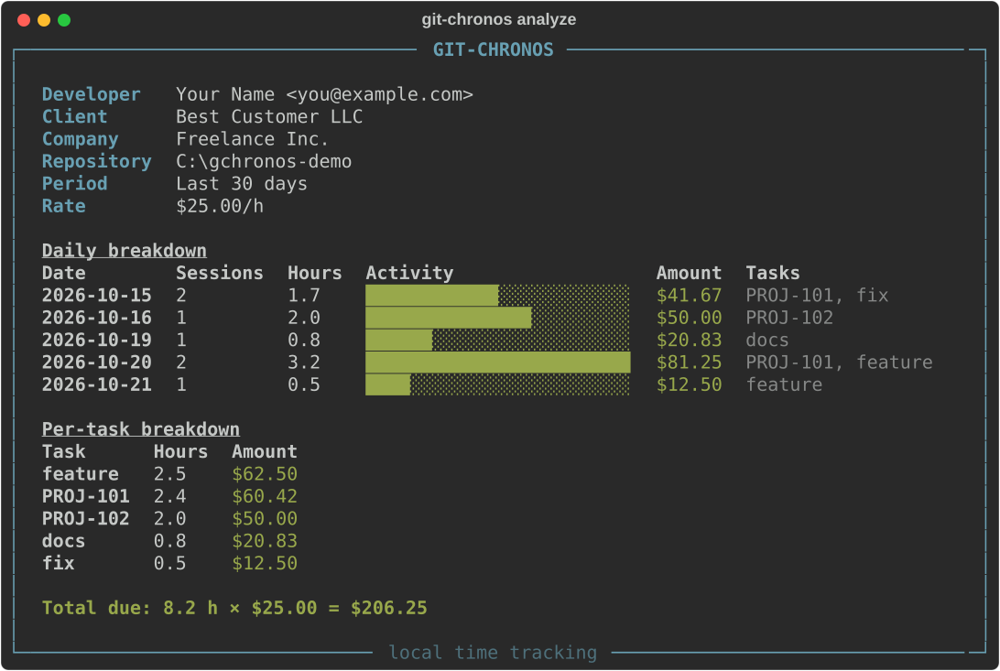
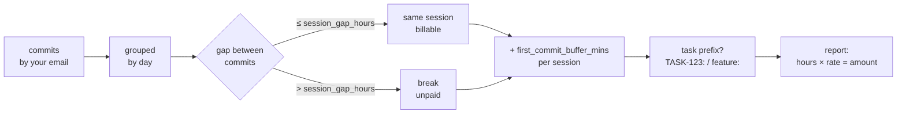

<div align="center">

# Git-Chronos

**Turn your Git history into billable hours — and invoices.**

[](https://pypi.org/project/git-chronos/)
[](https://www.python.org/)
[](LICENSE)

A local-first CLI for freelancers and contract developers. No timers to forget,
no cloud, no AI services — your `.git` folder already knows when you worked.

</div>

---


---

## Why

You write code first, commit second — Git-Chronos reads your commit history and
reconstructs billable sessions automatically:

- **Zero manual tracking** — hours are derived from real commits, not timers.
- **Session-aware** — gaps longer than a threshold count as unpaid breaks; a warm-up buffer is added before each session's first commit.
- **Task attribution** — `TASK-123:` or `feature:` prefixes map sessions to tasks.
- **Two report styles** — a Rich terminal dashboard and a corporate Excel invoice with real `=SUM()` formulas.
- **Private by design** — 100% offline; nothing leaves your machine.

---

## Installation

Python **3.10+** is required.

```bash
pip install git-chronos
```

Or straight from GitHub:

```bash
pip install git+https://github.com/KokosP/git-chronos
```

Or from source:

```bash
git clone https://github.com/KokosP/git-chronos
cd git-chronos
pip install .
```

---

## Quick start

```bash
git-chronos init        # creates ~/.git-chronos.toml
git-chronos status      # validates config, shows your rate
git-chronos analyze .   # analyzes the repo in the current directory
```

Set `developer.email` in the config to your `git config user.email` — only your
commits are counted.

---

## Commands

| Command | Description |
|---|---|
| `git-chronos init` | Creates the default `~/.git-chronos.toml` config file (`--force` to overwrite) |
| `git-chronos status` | Validates the config and prints current settings |
| `git-chronos analyze [PATH]` | Analyzes the repository at `PATH` (default: `.`) |

### `analyze` options

| Flag | Description |
|---|---|
| `--period`, `-p` | `week`, `month` (default), or `custom` |
| `--export`, `-e` | `terminal` (default), `excel`, or `both` |
| `--since` / `--until` | Date bounds `YYYY-MM-DD` (required for `--period custom`) |
| `--currency`, `-c` | Override currency for this run (`USD`, `EUR`, `GBP`, …) |
| `--rate`, `-r` | Override the hourly rate for this run |
| `--all` | Count commits across all branches and tags, not only HEAD |

```bash
git-chronos analyze ~/work/client-app --period month --export both
git-chronos analyze . --period custom --since 2026-10-01 --until 2026-10-15
git-chronos analyze . --all --currency EUR --rate 40
```

---

## Terminal dashboard



The [Rich](https://github.com/Textualize/rich) panel shows:

- **Header** — developer, client, company, repository, period, rate.
- **Daily breakdown** — sessions, hours, an activity bar, amount, and tasks per day.
- **Per-task breakdown** — hours and money per detected task.
- **Finance line** — `Total due: 8.2 h × $25.00 = $206.25`.

On terminals with a limited legacy encoding the glyphs fall back to ASCII
(`#`, `-`, currency codes) — the numbers stay the same.

## Excel invoice

`--export excel` writes a styled `.xlsx` next to your working directory:


- Slate Gray (`#34495E`) header with white text, alternating row shading.
- Formats: dates `YYYY-MM-DD`, hours `0.0`, money `"$"#,##0.00`.
- **Real formulas**: per-day `=Hours*Rate` and `=SUM(...)` totals — the invoice
  recalculates if you edit it.

---

## Configuration

`git-chronos init` writes `~/.git-chronos.toml`:

```toml
[developer]
name = "Ivan Ivanov"
email = "ivan@developer.dev"       # Filter: only count commits by this author

[finance]
currency = "USD"                   # ISO code: USD, EUR, GBP, RUB, ...
hourly_rate = 25.0                 # Hourly rate (price per 1 hour)

[algorithm]
session_gap_hours = 2.0            # Max. break between commits (in hours)
first_commit_buffer_mins = 30      # "Warm-up" time before the first commit of a session

[reporting]
company_name = "Freelance Inc."
client_name = "Best Customer LLC"
```

Known symbols: `$`, `€`, `£`, `¥`, `₹`, `₽`, `₴`, `₸` and more — any other ISO
code is used as-is (`SEK25.00`).

---

## How the time is counted



1. Commits are read via GitPython (HEAD, or every ref with `--all`) and filtered
   by `developer.email`.
2. Sorted chronologically, grouped by calendar day.
3. Consecutive commits within `session_gap_hours` form one session; the gap
   between sessions is rest and is not billed.
4. `first_commit_buffer_mins` is added before each session's first commit —
   code exists before it is committed.
5. A session inherits the task from the first commit message matching
   `PREFIX-123:` or `word:`; otherwise it is `General`.

---

## Project structure

```text
git-chronos/
├── git_chronos/
│   ├── __init__.py
│   ├── cli.py                 # Typer commands: init / status / analyze
│   ├── config.py              # ~/.git-chronos.toml loading & validation
│   ├── git_parser.py          # Commit extraction via GitPython
│   ├── analyzer.py            # Sessions, buffers, task detection
│   └── exporters/
│       ├── __init__.py
│       ├── excel.py           # Styled .xlsx invoice (openpyxl)
│       └── terminal.py        # Rich dashboard
├── docs/                      # Demo assets for this README
├── pyproject.toml
├── README.md
└── LICENSE
```

## Tech stack

| Library | Purpose |
|---|---|
| `typer` | Command-line interface |
| `gitpython` | Reading local Git history |
| `toml` | Config parsing |
| `rich` | Terminal dashboard |
| `openpyxl` | Excel invoice generation |

No external APIs. No AI services. Python 3.10+.

---

## License

This project is licensed under the [MIT License](LICENSE).

Copyright (c) sbgid.com
